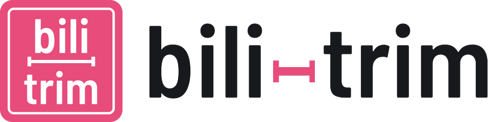

<p align="center">
  <picture>
    <source media="(prefers-color-scheme: dark)" srcset="assets/logo-dark.png">
    
  </picture>
</p>

把 B站 Android 緩存影片裡的工商片段剪掉，**剪完還是在 B站 App 裡播** ——
播放器、彈幕、進度記憶全部照舊。

不是轉檔、不是另存，是直接在 App 的緩存檔上動刀，所以 App 認得它。

*Cuts sponsor segments out of Bilibili's Android offline cache in place, so the
videos still play inside the Bilibili app — same player, same danmaku, same
resume position. Chinese-only UI and docs.*

```
bili-trim.bat   原始碼版的入口：點兩下就開始（找 Python → run.py）；一般使用者用 Releases 的 exe
run.py          入口：驗 Python 版本、補缺的套件，然後開視窗
setup.py        命令列版的安裝，另外負責打包帶去別台電腦
bili_gui.py     圖形介面（挑廣告、即時預覽、一鍵寫回手機）
bili_trim.py    剪輯引擎 + 命令列版本（純標準庫，不需要 ffmpeg）
bili_device.py  adb：找裝置、找 B站 路徑、列緩存、拉取／推送
bili_backup.py  單檔備份（.bilibak）與還原
bili_media.py   預覽用的影格來源與播放器（ffmpeg / ffplay）
bili_font.py    準備介面字型：固定 Noto 的字重、把缺的字合併進內文字型
bili_look.py    介面的樣子：稿紙的顏色、字級、主題（換主題只改這裡）
fonts/          介面數字用的 Barlow Semi Condensed（SIL OFL 1.1，見 fonts/OFL.txt）
assets/         圖示、字標、GitHub 分享圖；都是 assets/make_icon.py 畫的
bili_env.py     找 adb / ffmpeg（先看 AppData 的 tools，再看 PATH）、從下載好的 zip 裝工具、環境自我檢查
bili_drop.py    讓檔案總管裡的檔案可以拖進視窗（Windows）
bili_filedlg.py 「選擇檔案」用 Windows 原生的開啟視窗（跟檔案總管同一個）
bili_config.py  設定檔（備份位置等），setup.py 會先幫你寫好
```

---

## 先說清楚

- 這個工具會**直接改 B站 App 的緩存檔**。寫入前一定會先備份一份乾淨原檔
  （不是選項，是強制的），但請自己確認那份 `.bilibak` 真的在。
- 跟 B站 官方沒有任何關係，也沒有用到任何官方介面 —— 它只是讀寫
  手機上已經存在的檔案。
- 請只對**你自己在 App 裡下載的內容**使用。剪掉的片段不會離開你的手機，
  這個工具不會上傳、不會解密、不會繞過 DRM，也不幫你把影片存出來。
- **B站 App 更新之後行為可能改變。** 下面那張表是在某個版本上實測的結果，
  不是官方保證。覺得不對就先用 `--apply` 之外的乾跑模式看數字。

### 測過的環境

| | |
| --- | --- |
| 開發與實測 | Windows 11、Python 3.14、一支 Android 手機（國際版 Bilibili） |
| 寫得出來但沒實測 | macOS、Linux（路徑與下載來源都寫好了，沒有機器驗過） |
| 沒支援 | 舊版 FLV 分段緩存、沒下載完的緩存 |

---

## 為什麼是這種做法

這幾點都是逐項二分搜尋實測出來的，不是推測。測試方式是每次只改一個變數、
推回手機、用 logcat 依 cid 判定播放結果，每次推送前都在裝置上重算 md5 核對。

| 對緩存檔做的事 | B站 App 的反應 |
| --- | --- |
| 改內容位元組（翻轉 1 byte） | 可以播 |
| 檔尾附加位元組（檔案變大） | 可以播 |
| 改 `entry.json` 的 `total_bytes` / 時長 | 可以播 |
| 改檔案內的 `mvhd` / `tkhd` / `mehd` | 可以播 |
| 改 `moof` 裡的時間數值（`tfdt` / `trun`） | 可以播 |
| 減少 `sidx` 的參考項（大小不變） | 可以播 |
| **ffmpeg 重新封裝（即使完全不剪）** | **卡在「正在緩衝」** |
| **移除 fragment 讓檔案變小** | **卡在「正在緩衝」** |

結論兩點：

1. **不能用 ffmpeg 重封裝。** 它的 `+empty_moov` 不寫 `mehd`/`elst`、
   `mvhd`/`tkhd` 時長留 0、`sidx` 寫成 version 1 —— 整體就是跟 B站 不同的檔案。
   所以本工具完全不靠 ffmpeg 改容器，自己讀寫 box。
2. **檔案不能比原本小。** 推測是下載管理器拿它資料庫裡記的大小比對，發現比較小
   就判定下載不完整、去向 CDN 續傳，而那些網址早就過期了（`deadline=…`），
   於是永遠緩衝、而且不會報網路錯誤。
   所以移除 fragment 之後，尾端補一個 `free` box 把大小補回原值。

### 代價

- **手機容量不會變少。** 廣告是真的被移除了（時間軸連續接起來、時長真的變短），
  但檔案大小一模一樣。這是上面第 2 點換來的。
- **視訊切點精度 = GOP 長度（B站 大約 5 秒）。** 每個 fragment 開頭才是關鍵影格，
  只能整塊移除。GUI 的時間軸下方那排細刻度就是 fragment 邊界，放大就看得到
  切點會被吸附到哪裡。音訊可以精切（約 23 ms），所以音畫不會飄。
- **剪過的可以再剪，但時間是以目前這一版為準。** 剪完時間軸就接起來了，
  原本 10:00 的畫面現在在 8:00。工具認得出「剪過的檔案」（尾端那塊補大小用的
  `free` box）並會提醒你，但不會擋你 —— 備份是後悔藥，不該是編輯的前提。
  要小心的只有一件事：**別把上次用過的切點時間再貼一次**，那些位置現在已經
  是正片了。在 GUI 裡拖時間軸挑不會有這個問題，因為你看到的就是目前這一版。

---

## 開始用

1. 到 [**Releases**](https://github.com/yeyeye0618/bili-trim/releases/latest)
   下載 **`bili-trim.exe`**，放到你自己的資料夾
   （桌面、文件都可以，不要放 `Program Files`，那裡寫不進去）。不用裝 Python
2. **點兩下 `bili-trim.exe`**（圖示是一顆紅色的「b」印章）。
   第一次 Windows 可能跳「Windows 已保護您的電腦」：按**其他資訊 → 仍要執行**
   （exe 沒有數位簽章，不是中毒）
3. 少了 `adb` 或 `ffmpeg` 的話，程式會自己跳出**環境檢查**視窗：按「下載 adb」，
   下載好的 zip **直接拖進視窗**（不用解壓縮）。程式會檢查 zip、挑出需要的檔案放好、
   試跑一次，然後自己去找手機
4. 手機接上電腦、開「USB 偵錯」，按左下角的**重新掃描手機**

### 從原始碼跑（有 Python、想改程式的人）

1. **Code → Download ZIP**，解壓到你自己的資料夾
2. **點兩下 `bili-trim.bat`**
3. 第一次會問要不要裝三個 Python 套件，按 Enter 就好

沒有 Python 的話，第 2 步會告訴你去裝；裝完再點一次同一個檔案。
（`winget install -e --id Python.Python.3.12`，或到
[python.org](https://www.python.org/downloads/) 下載，安裝畫面最下面
記得勾 **Add python.exe to PATH**。）

### 不想接線：用 Wi-Fi

Android 11 以上可以用「**無線偵錯**」代替 USB，能做的事完全一樣。手機和電腦要在
同一個區網（電腦用網路線接同一台路由器也行）。

1. 手機：開發人員選項 →「**無線偵錯**」打開
2. 程式：點頂端的裝置晶片 →「**用 Wi-Fi 連線…**」
3. **第一次要配對**：手機上點「使用配對碼配對裝置」，把視窗裡的 IP:埠號和
   6 位數配對碼填進去，按「配對」。配對好會自動連上，程式會記住這支手機
4. 之後開程式（或按「重新掃描手機」）會**自己用 Wi-Fi 重新連上**。無線偵錯的埠號
   每次重新打開都會變，程式會自己試出新的那個（約 3 秒），不用再填；配對也不用重做

「用 Wi-Fi 連線」裡的「**找手機**」會列出找到的手機和它現在的埠號，選一支按
「連線」就好。只知道手機 IP 的話，填在「只知道手機的 IP」，程式一樣會幫你試出埠號。

要注意的地方：

- **找手機和傳檔的時候，手機螢幕要亮著。** 有些手機（實測：vivo）螢幕鎖過之後
  會悄悄停掉無線偵錯，設定畫面卻還寫著開著、還顯示舊的埠號 —— 那個埠其實已經
  不能連。這時候在手機上把無線偵錯**關掉再打開**，再按一次「找手機」。
- 試埠號的做法是把那支手機的高位埠號（32768–60999）都敲一下，看哪一個是 adb。
  程式只對**用 Wi-Fi 連過的手機**和**你填的 IP** 這樣做，不會去掃網路上其他裝置。
- 有些手機會在網路上廣播自己的位址，有些不會；有些網路（學校、公司）也會擋這種
  廣播。有廣播就直接用，沒有就靠上面那招試出來。
- 配對和連線用的是**兩組不同的埠號**：配對看「使用配對碼配對裝置」那個視窗，
  連線看「無線偵錯」主畫面上的「IP 位址和通訊埠」。
- 速度看你的 Wi-Fi：實測拉一支 34 MB 的影片 4.6 秒；訊號差的時候會慢很多。
- 不想讓它自動重連：裝置選單裡選「中斷這支的 Wi-Fi 連線」。
- **藍芽不行。** adb 只能走 USB 或網路，藍芽傳檔也進不去 B站 的快取資料夾
  （`Android/data/` 底下，Android 11 起連手機上的檔案管理員都進不去）。

### 要自己準備的兩個外部程式

這兩個不是 pip 裝得到的東西，請自己下載 —— 程式不會偷偷幫你抓：

| | 去哪裡拿 | 放哪裡 | 沒有的話 |
| --- | --- | --- | --- |
| **adb** | [Android SDK Platform-Tools](https://developer.android.com/tools/releases/platform-tools) | `adb.exe` 和旁邊的 `AdbWinApi.dll`、`AdbWinUsbApi.dll` | 完全不能用 |
| **ffmpeg** | [gyan.dev 的 release-essentials.zip](https://www.gyan.dev/ffmpeg/builds/ffmpeg-release-essentials.zip)（[ffmpeg.org](https://ffmpeg.org/download.html) 列的 Windows 建置） | `ffmpeg`、`ffplay`、`ffprobe` 三個執行檔 | 預覽不能用，剪輯還是可以 |

**放法：把下載好的 zip 拖進程式視窗**（或環境檢查裡的「選擇檔案…」）。程式會核對
zip 有沒有下載完整、只挑上面那幾個檔案放進 tools 資料夾、再試跑一次確定能用。
已經解開的資料夾拖進來也可以。

tools 資料夾是 **`%LOCALAPPDATA%\bili_trim_gui\tools`**，exe 和原始碼版共用這一份：
在哪個版本裝的，另一個版本都找得到。以前放在專案裡 `tools/` 的，原始碼版開起來時
會自己複製過去（原本的不會刪）。

**不用改 PATH。** 程式先看 tools 資料夾，再看 PATH ——
已經有 adb／ffmpeg 的人不受影響，沒有的人也不必去翻「系統環境變數」。
那是這個專案以前最大的摩擦：下載、解壓、新增一列、重開終端機，
任何一步漏掉，看到的都只是一句「找不到 adb」，而且看不出是哪一步錯。

要放在別的地方也行：環境變數 `BILI_TOOLS` 指到那個資料夾，或是
`BILI_ADB` / `BILI_FFMPEG` / `BILI_FFPLAY` / `BILI_FFPROBE` 直接指到執行檔。

### 不想一步一步來

```bash
python setup.py
```

命令列版的安裝，一路做到「接上手機、影片列得出來」為止。比點兩下多做這些事：

| 步驟 | 內容 |
| --- | --- |
| Python 套件 | 裝到「現在跑的這個」直譯器 |
| 外部工具 | **問過你之後**才從官方來源下載，放進 `%LOCALAPPDATA%\bili_trim_gui\tools` |
| 字型 | 先把介面字型準備好（約一分鐘），省得第一次開程式時等 |
| 啟動方式 | 把它用的那個 Python 記進 `python-path.txt`，啟動檔會優先讀它 |
| 設定 | 問備份位置、建好資料夾、寫進設定檔 |
| 手機 | 等你把 USB 偵錯打開並授權，然後找 B站 的緩存目錄、列一次影片 |

最後一步會**一直等**，不是檢查一次就放棄 —— 使用者的時間都花在手機上
（連點七次版本號碼、翻開發人員選項、按授權對話框），檢查一次就說
「沒偵測到手機」等於叫人自己重跑。沒接手機、接了沒授權、offline，
三種狀態的下一步都不一樣，所以會分開講。它也會分清楚「手機上沒裝 B站」
和「裝了但下載目錄還不存在」（目錄要在 App 裡下載過一支影片才會建出來）。

`python-path.txt` 這件事是因為一台電腦常常有好幾個 Python（市集版、
python.org 版、conda…）。套件裝在哪一個就要用哪一個開，不然就會
「明明裝好了卻說找不到 dearpygui」。

其他選項：`--check` 只檢查不動手、`--yes` 所有詢問都當同意、`--offline`
不下載、`--skip-font` 不建字型、`--backup-dir PATH` 直接指定備份位置、
`--pack` 打包（見下一節）。

### 做成一個 exe（對方不用裝 Python）

```bash
python setup.py --exe
```

用 PyInstaller 把 Python、介面套件、字型整個封成 `dist\bili-trim.exe`（約 40 MB），
第一次會問要不要裝 PyInstaller。

發版不用自己做：推一個 `v` 開頭的 tag（`git tag v0.2.0`、`git push origin v0.2.0`），
GitHub Actions（`.github/workflows/release-exe.yml`）會在 Windows 上做好 exe、
掛到同名的 Release；Release 還沒有的話會先建一個草稿。

拿到 exe 的人：

1. 把 `bili-trim.exe` 放到任何自己的資料夾（不要放 `Program Files`）
2. 點兩下 `bili-trim.exe`
3. adb 和 ffmpeg 一樣要自己準備：已經在 PATH 裡就不用管；沒有的話把下載好的
   zip 拖進視窗，會裝到 `%LOCALAPPDATA%\bili_trim_gui\tools`

幾件要知道的事：

- **adb 和 ffmpeg 不會封進 exe。** 理由跟 `--pack` 那段一樣（授權不同）。
- **exe 旁邊不會多出任何東西。** 工具和從手機拉下來的暫存放在
  `%LOCALAPPDATA%\bili_trim_gui\`（`tools`、`stage`）；設定和字型快取在
  `%APPDATA%\bili_trim_gui\`。工具、設定、字型都跟原始碼版共用，兩個版本可以輪流用。
- **第一次開會比較慢**：exe 要先把自己解開（每次幾秒），在新電腦上還要準備介面字型
  （約一分鐘，在背景做）。
- **Windows 可能會擋。** exe 沒有數位簽章，SmartScreen 會跳「Windows 已保護您的電腦」，
  按「其他資訊 → 仍要執行」。有些防毒軟體也會對 PyInstaller 做的 exe 過度敏感。
- 開不起來的話會跳一個訊息框，完整的錯誤記錄在
  `%APPDATA%\bili_trim_gui\bili-trim-error.log`。

### 帶去另一台電腦

```bash
python setup.py --pack
```

產生 `bili-trim-portable.zip`，**連 adb 和 ffmpeg 一起包進去**（放在包裡的 `tools/`；
加 `--no-tools` 可以不包）。在新電腦解壓之後點兩下 `bili-trim.bat`，程式第一次開時
會把它們裝進那台電腦的 `%LOCALAPPDATA%\bili_trim_gui\tools`，不用再下載一次。

> 這個包是給自己搬家用的，不適合公開散佈 —— 裡面的 ffmpeg 多半是 GPL
> 授權的建置，platform-tools 也有自己的條款，跟本專案的 MIT 不是同一回事。

### 出問題的時候

程式裡：右上角**說明 → 環境檢查**。視窗只講缺什麼、怎麼補；按
**把詳細結果寫進訊息**會逐項列出 Python、三個套件、adb／ffmpeg／ffplay／ffprobe
在哪裡、介面字型、備份位置，訊息視窗的**全部複製**可以整段貼出來。

**手機接上了卻找不到**：程式會自己分出是哪一種，跳出視窗講下一步。

| 視窗說 | 原因 | 怎麼辦 |
| --- | --- | --- |
| 還沒開「USB 偵錯」 | 手機只用「傳輸檔案」接著 | 照視窗的三步打開開發人員選項和 USB 偵錯 |
| 手機在問：允許 USB 偵錯嗎？ | 等你在手機上按 | 按「允許」；沒看到就按「再問一次」 |
| Windows 還少一個設定 | Windows 用內建的 WinUSB 接上了 adb 介面，但手機沒附上 adb 找它用的介面 GUID（vivo 等） | 按「補上設定」：Windows 會問要不要允許，它只替這個介面補上 `DeviceInterfaceGUIDs`，不裝任何東西 |
| 沒有這支手機的 adb 驅動程式 | adb 介面完全沒有驅動 | 按「下載驅動程式」裝 Google USB Driver |

命令列：

```bash
python setup.py --check
```

同一份檢查，外加看一次手機：連得上就把緩存目錄和影片數量也列出來。

兩個刻意不偷懶的地方：

- **工具會真的執行一次問版本**，不只看檔案在不在。被防毒軟體隔離、
  抄到一半、少了旁邊的 dll，這些情況檔案都還在，但一跑就死。
- **套件是開一個新的行程去 import**。`pip --user` 的目標目錄如果在啟動時
  還不存在，Python 就不會把它放進 `sys.path`，於是同一個行程裝完照樣
  `import` 不到 —— 在自己這裡判斷會得到「剛裝好卻說沒裝」的錯誤結論。

### 關於字型

B站 的標題什麼字都有：繁中、簡中、假名、韓文，還有 `♡ ❤ ┊ ⌇` 和 `💓 💦`。
Android 顯示得出來是因為系統有字型後備鏈，但 Dear PyGui 一次只綁一個字型檔，
缺的字會畫成 `?` —— 而且掃過本機所有大字型，涵蓋最好的也還缺 7 個字。

所以會把缺的字從其他系統字型子集化之後**合併成一個字型檔**，之後快取起來
不用再做。介面用三套字，兩套是 Windows 11 內建的，數字那套專案自己帶著：

| | 字型 | 用在 |
| --- | --- | --- |
| 內文 | Noto Sans TC | 清單、說明、按鈕 |
| 標題 | Noto Serif TC | 區塊標題、資訊欄裡的影片標題 |
| 數字 | Barlow Semi Condensed（專案的 `fonts/` 裡） | 時間碼、刻度、位元組（等寬數字，播放時不會抖） |

要先加工一次：Noto 是可變字型，直接給 Dear PyGui 會畫成最細的 Thin，所以
用 fontTools 固定成需要的粗細；Windows 版的 Noto Sans TC 只收繁體字，
簡體字（们、说、这…）和日文漢字從微軟正黑體補進來；Barlow 的數字預設
是比例寬，改用它自己的等寬數字字形。全部約一分鐘，第一次開程式會在背景做（這段
時間先用系統字型），`setup.py` 會先做好。

Windows 10 沒有 Noto，會退回微軟正黑體，功能完全一樣。
這需要 `fonttools`，沒裝也能跑，只是補不到的字會顯示成 `?`。
做好的字型放在 `%APPDATA%\bili_trim_gui\fonts\`。

還是看到 `?` 的話，跑這個會告訴你卡在哪裡 —— 用的是哪個 Python、補字字型
建好了沒、以及手機上每一筆標題還缺哪些字元：

```bash
bili-trim.bat --check-font
```

---

## 用法

### 圖形介面

點兩下 `bili-trim.bat`（或 `python run.py`）。

畫面是三欄：左邊是手機上的快取，中間是畫面和時間軸，右邊是「這一支」的資料
和寫入按鈕。

1. 接上手機，按左下角**重新掃描手機** —— 會自己找 B站 的緩存目錄、列出所有影片
2. 選一支，右邊按**載入以編輯**（從手機拉到本機暫存，之後重用不必再拉）
3. 拖時間軸找廣告：滾輪縮放、拖空白處平移、點一下跳到該處，
   `I` / `O` 設起訖點（或按區間表最下面那列的按鈕），再按**加入**
4. 時間軸上的格子就是 fragment：要移除的段落會畫上一條硃砂紅的刪除號，
   切點只會落在格線上
5. 切到**成品**模式按播放 —— 播到接縫會直接跳過被移除的段落，
   聽得出來接得乾不乾淨
6. 微調：拖刪除號的兩端，或在區間表裡直接改時間
7. 右邊的**備份並寫入手機** —— 會先強制備份，然後推回去並在裝置上重算 md5 核對

底下那一列是最新一則訊息；完整的紀錄按右下角**訊息**打開（出錯時會自己打開）。

快速鍵：`空白鍵` 播放／暫停、`I` 設起點、`O` 設終點、`←` `→` 單格移動、`Home` 回開頭。

右上角**設定**裡可以調：音量、音訊延遲、預覽畫質、**介面字級**（小／標準／大／
特大／超大）。字級改了會連按鈕、欄位、時間軸一起放大，不會只有字變大然後被
切掉；選取的影片、剪輯區間、播放位置都會保留。設定記在
`%APPDATA%\bili_trim_gui\settings.json`。

### 命令列

```bash
# 乾跑，只看會改什麼
python bili_trim.py <cid 目錄> --cut 195-247 --cut 10:12-11:00

# 直接對手機上的路徑操作
python bili_trim.py --device /sdcard/Android/data/com.bilibili.app.in/download/<avid>/<cid> \
                    --cut 195-247 --apply
```

主要選項：`--snap {outer,inner}` 切點吸附方向、`--preview-seams [秒數]` 擷取接縫
對照片段、`--refresh` 忽略暫存重新拉、`--allow-incomplete` 連沒下載完的也剪。

---

## 支援的 B站 版本

| 套件名 | 版本 |
| --- | --- |
| `com.bilibili.app.in` | 國際版 Bilibili |
| `tv.danmaku.bili` | 大陸版 哔哩哔哩 |
| `com.bilibili.app.blue` | 概念版 哔哩哔哩 |

每個套件都會試這些位置（`{pkg}` 代入套件名）：

```
/storage/emulated/0/Android/data/{pkg}/download
/sdcard/Android/data/{pkg}/download
/storage/emulated/0/Android/data/{pkg}/files/download
/sdcard/Android/data/{pkg}/files/download
```

只處理 DASH 緩存（`media_type=2`，有獨立 `video.m4s` / `audio.m4s`）。
舊版的 FLV 分段格式不支援。沒下載完的（`is_completed=false`）會被擋下來。

---

## 備份

寫入前**一定**會先備份，而且備的是乾淨原檔。備份是**一個檔案**，不是資料夾：

```
<備份位置>/<影片標題>.bilibak
```

`.bilibak` 是未壓縮的 zip（影音已經壓縮過，再壓只是浪費時間）：

```
manifest.json          哪支影片、原本在手機哪裡、每個檔案的大小與 md5
payload/entry.json
payload/danmaku.xml
payload/<type_tag>/index.json
payload/<type_tag>/video.m4s
payload/<type_tag>/audio.m4s
```

檔名用影片標題（不是 cid 那串數字），撞名自動加 `(2)`。
還原：**備份 → 還原備份…** → 選一個 → **還原到手機**，會逐檔核對 md5。

> 注意：如果你在 App 裡把那支影片刪掉了，光把檔案放回去沒用 ——
> B站 的資料庫裡沒有那筆記錄。要先在 App 裡重新下載，再還原覆蓋上去。

---

## 本機暫存

`bili_gui_stage/<cid 目錄>/`（exe 版是 `%LOCALAPPDATA%\bili_trim_gui\stage`）
是**手機上那一份的鏡像**，旁邊的
`.bili_gui_stage.json` 記著每個檔案的大小、md5，以及這支被剪過幾次。

- 下次載入同一支會先驗這份暫存，驗得過就直接重用，不必再拉幾百 MB
- 手術在另一個 `.out` 目錄做，推成功之後才把暫存更新成新版本
- 所以你在介面上看到、拖曳、預覽的，永遠就是手機上現在那一版 ——
  要再剪一段廣告，時間直接照畫面上標就對了

暫存很佔空間（一支就是原檔大小），不需要了直接刪整個 `bili_gui_stage`。
**但先確認手機上那支還是原檔，或者你已經有 `.bilibak` 備份** ——
不然那可能是你唯一的原檔副本。

---

## 授權

程式碼是 MIT，見 [LICENSE](LICENSE)。

`fonts/` 裡的 Barlow Semi Condensed 是 The Barlow Project Authors 的作品，
以 SIL Open Font License 1.1 授權（見 [fonts/OFL.txt](fonts/OFL.txt)），
原檔照 Google Fonts 發佈的樣子放著，沒有修改。
